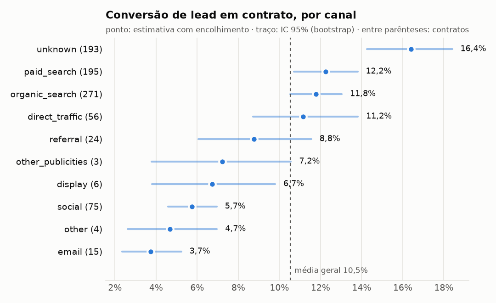
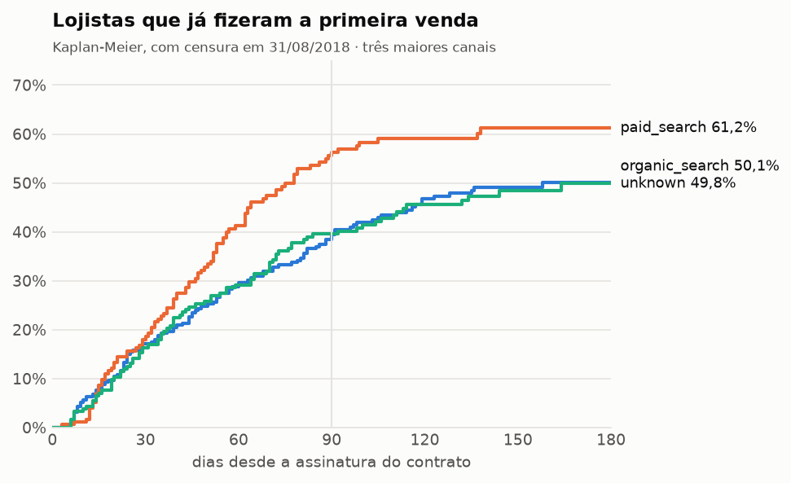

# Growth Review

Gerado por `reconcile crescimento` a partir da camada única. Não edite os números à mão.

## Em uma frase

O canal decide **quantos** leads viram contrato, não **quanto** cada contrato vende: a receita por contrato nos primeiros 180 dias é a mesma em todos os canais dentro do ruído, e um lead de busca vale cerca de 2 vezes um de rede social. Mas o maior vazamento do funil não está na aquisição: 47,0% dos lojistas contratados não fazem nenhuma venda em 180 dias.

## Recomendações

1. **Concentrar a verba em busca (paga e orgânica) e rever social e e-mail.** Busca converte 12,2% e 11,8% dos leads; social converte 5,7% e e-mail 3,7%, com intervalos que não se cruzam com os de busca. Como a receita por contrato não muda com o canal, a escolha do canal é uma escolha de conversão.

2. **Tratar ativação como meta, com o mesmo peso da aquisição.** Só 43,8% dos contratados vendem em 90 dias e 53,0% em 180: a curva desacelera depois de 90 dias, com só mais 9 pontos nos 90 dias seguintes. Um programa de onboarding nos primeiros 90 dias ataca o ponto em que o lojista ainda pode ser recuperado. Cada contrato que ativa vende, em média, cerca de R$ 2.914 nos primeiros 180 dias.

3. **Consertar o registro de origem antes de decidir verba.** 14,5% dos leads e 22,9% dos contratos não têm canal (`unknown`), e é justamente o grupo que mais converte (16,4%). Se forem leads de indicação ou de vendas internas mal registrados, o canal mais eficiente está invisível. Tornar o campo obrigatório no CRM custa pouco e destrava a recomendação 1.

## Valor de um lead, por canal

Valor = P(lead vira contrato) × receita bruta média de um contrato nos 180 dias seguintes. A conversão usa os 8.000 leads; a receita usa só os contratos com 180 dias observados por inteiro. As duas partes são encolhidas para a média geral e o intervalo vem de 2.000 reamostras (bootstrap).

| canal | leads | contratos | conversão (IC 95%) | vendas em 180 dias por lead (IC 95%) | receita da Olist por lead, taxa de 10% |
|---|---:|---:|---|---|---:|
| unknown | 1.159 | 193 | 16,4% (14,2% a 18,4%) | R$ 253 (R$ 105 a R$ 483) | R$ 25 |
| paid_search | 1.586 | 195 | 12,2% (10,7% a 13,8%) | R$ 189 (R$ 76 a R$ 369) | R$ 19 |
| organic_search | 2.296 | 271 | 11,8% (10,5% a 13,0%) | R$ 182 (R$ 73 a R$ 345) | R$ 18 |
| direct_traffic | 499 | 56 | 11,2% (8,7% a 13,8%) | R$ 172 (R$ 67 a R$ 338) | R$ 17 |
| referral | 284 | 24 | 8,8% (6,1% a 11,6%) | R$ 135 (R$ 52 a R$ 269) | R$ 14 |
| other_publicities | 65 | 3 | 7,2% (3,8% a 10,6%) | R$ 111 (R$ 36 a R$ 233) | R$ 11 |
| display | 118 | 6 | 6,7% (3,8% a 9,8%) | R$ 104 (R$ 36 a R$ 215) | R$ 10 |
| social | 1.350 | 75 | 5,7% (4,6% a 6,9%) | R$ 89 (R$ 35 a R$ 175) | R$ 9 |
| other | 150 | 4 | 4,7% (2,6% a 7,0%) | R$ 72 (R$ 24 a R$ 144) | R$ 7 |
| email | 493 | 15 | 3,7% (2,3% a 5,2%) | R$ 58 (R$ 21 a R$ 120) | R$ 6 |

**Por que a receita por contrato é igual entre canais.** Antes do encolhimento as médias variam muito (o `unknown` tem R$ 3.261, mas um único lojista responde por 74,9% da receita do canal e a mediana é R$ 52). Ainda assim, a variação entre canais é menor que a esperada só pelo acaso com tão poucos contratos observados (de 1 a 69 por canal). O melhor palpite para qualquer canal é a média geral, R$ 1.544.

**Sensibilidade à taxa da Olist.** A base não informa a comissão que a Olist cobra do lojista, então a receita da Olist é uma premissa. Como ela multiplica o valor de todos os canais pelo mesmo número, a ordem dos canais não muda com a taxa; muda só o valor absoluto:

| canal | taxa 5% | taxa 10% | taxa 15% | taxa 20% |
|---|---:|---:|---:|---:|
| unknown | R$ 13 | R$ 25 | R$ 38 | R$ 51 |
| paid_search | R$ 9 | R$ 19 | R$ 28 | R$ 38 |
| organic_search | R$ 9 | R$ 18 | R$ 27 | R$ 36 |
| direct_traffic | R$ 9 | R$ 17 | R$ 26 | R$ 34 |
| referral | R$ 7 | R$ 14 | R$ 20 | R$ 27 |

## Ativação: do contrato à primeira venda

| canal | contratos | vendeu em 30 dias | em 90 dias | em 180 dias |
|---|---:|---:|---:|---:|
| todos | 842 | 17,0% | 43,8% | 53,0% |
| organic_search | 271 | 17,1% | 39,4% | 50,1% |
| paid_search | 195 | 18,6% | 56,3% | 61,2% |
| unknown | 193 | 16,3% | 39,6% | 49,8% |
| social | 75 | 11,7% | 45,1% | 49,4% |
| direct_traffic | 56 | 22,2% | 47,0% | 61,0% |
| referral | 24 | 22,1% | 38,5% | 46,2% |
| email | 15 | 7,1% | 38,1% | 45,8% |

Canais com menos de 15 contratos ficam fora da tabela. As frações usam Kaplan-Meier: contrato assinado perto do fim da base conta enquanto foi observado e sai da conta depois, em vez de entrar como "nunca vendeu".

## Premissas e limites

- **Janela de 180 dias.** Nenhum contrato tem 12 meses observados (o mais antigo é de dez/2017 e a observação termina em 31/08/2018).
- **Receita é a do lojista (GMV), não a da Olist.** A receita da Olist depende da taxa, que é premissa.
- **Correlação, não efeito causal.** Um canal que converte mais pode atrair lojistas diferentes; o que a análise sustenta é de onde os contratos vieram, não o que aconteceria mudando a verba.
- **Pouca amostra em canais pequenos.** 842 contratos em 10 canais; por isso o encolhimento e os intervalos.
