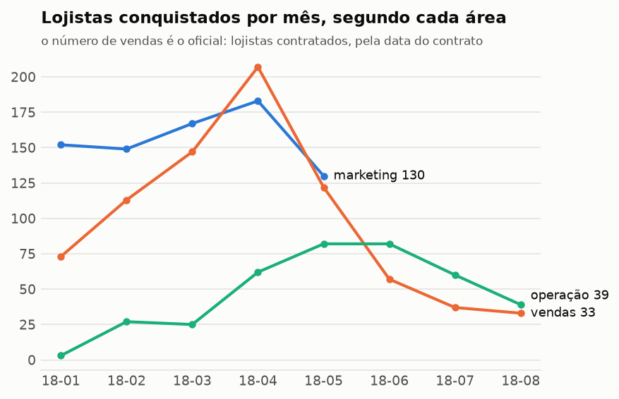
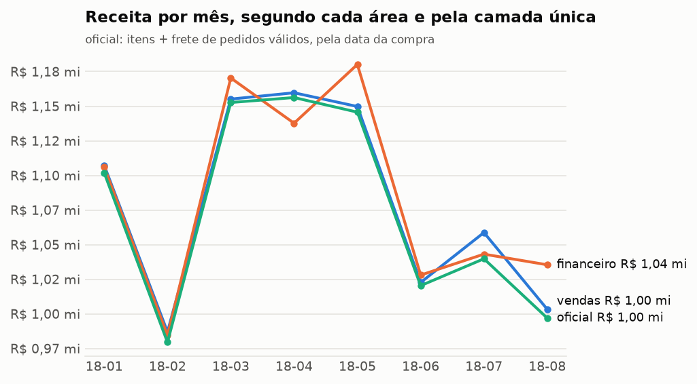

# Painel

Gerado por `reconcile painel` a partir dos marts. Não edite os números à mão.

Cada número desta página vem da camada única, com as regras do [contrato de métricas](contrato_de_metricas.md). Os gráficos mostram, ao lado, o que cada área responderia sozinha.

## As métricas do contrato, mês a mês

| mês | contratados | ativados | leads | clientes novos | pedidos válidos | receita bruta | receita paga | ticket médio |
|---|---:|---:|---:|---:|---:|---:|---:|---:|
| jan/2018 | 73 | 3 | 1.141 | 6.951 | 7.187 | R$ 1,1 mi | R$ 1,1 mi | R$ 153,32 |
| fev/2018 | 113 | 27 | 1.028 | 6.356 | 6.624 | R$ 1,0 mi | R$ 1,0 mi | R$ 147,87 |
| mar/2018 | 147 | 25 | 1.174 | 6.931 | 7.168 | R$ 1,2 mi | R$ 1,2 mi | R$ 160,81 |
| abr/2018 | 207 | 62 | 1.352 | 6.698 | 6.919 | R$ 1,2 mi | R$ 1,1 mi | R$ 167,11 |
| mai/2018 | 122 | 81 | 1.303 | 6.586 | 6.833 | R$ 1,1 mi | R$ 1,2 mi | R$ 167,67 |
| jun/2018 | 57 | 82 | 0 | 5.920 | 6.145 | R$ 1,0 mi | R$ 1,0 mi | R$ 166,05 |
| jul/2018 | 37 | 60 | 0 | 6.017 | 6.233 | R$ 1,0 mi | R$ 1,0 mi | R$ 166,82 |
| ago/2018 | 33 | 39 | 0 | 6.209 | 6.421 | R$ 1,0 mi | R$ 1,0 mi | R$ 155,27 |

Setembro e outubro de 2018 ficam de fora: a base tem 20 pedidos nesses meses.
